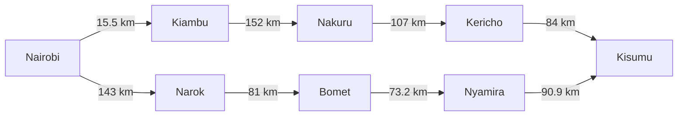
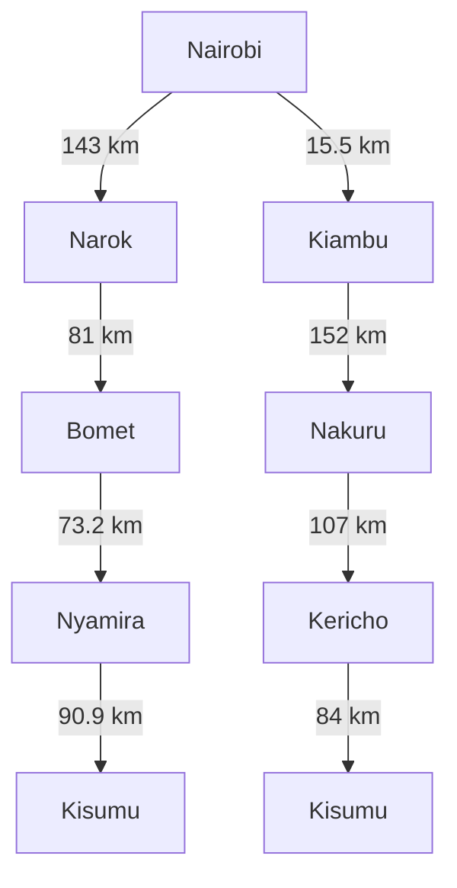

# Designing a Searching Agent
## Agent Design
### PEAS Framework
| Component | Description |
|---|---|
| Performance Measure |Minimise travel distance and time, Finding valid routes, Avoid collisions, Obey traffic rules |
| Environment |Kenya highway network, Other vehicles, Pedestrians, Traffic signs |
| Actuators |Steering wheel, Accelerator, Brakes, Gears, Lights |
| Sensors |Cameras, Speedometer, Proximity sensors, Engine sensors, GPS |
### Classification of the Agent Environment
|Classification|Reason|
|---|---|
|Partially Observable|Information about the environment is not fully available|
|Stochastic|Changes in environment are controlled by many factors, some beyond the agent's control e.g other vehicles or weather|
|Sequential|The agent's next choice is determined by its previous choices|
|Dynamic|The environment can change while the agent makes a decision|
|Multi-agent|The agent operates with other agents in the environment e.g other vehicles|
## Directed Graph and Search Tree
### Directed Graph

### Search Tree

### Determining the Optimal path
Path = Sum of road segments  
Optimal path = Min (path)  
#### Path 1
|Location|Distance|
|---|---|
|Nairobi|xxx|
|Narok|143 km|
|Bomet|81 km|
|Nyamira|73.2 km|
|Kisumu|90.9 km|
|Total|388.1 km|
#### Path 2
|Location|Distance|
|---|---|
|Nairobi|xxx|
|Kiambu|15.5 km|
|Nakuru|152 km|
|Kericho|107 km|
|Kisumu|84 km|
|Total|358.5 km|
#### Optimal path
Min (388.1, 358.5) = 358.5  
Therefore path 2 is the shortest path.